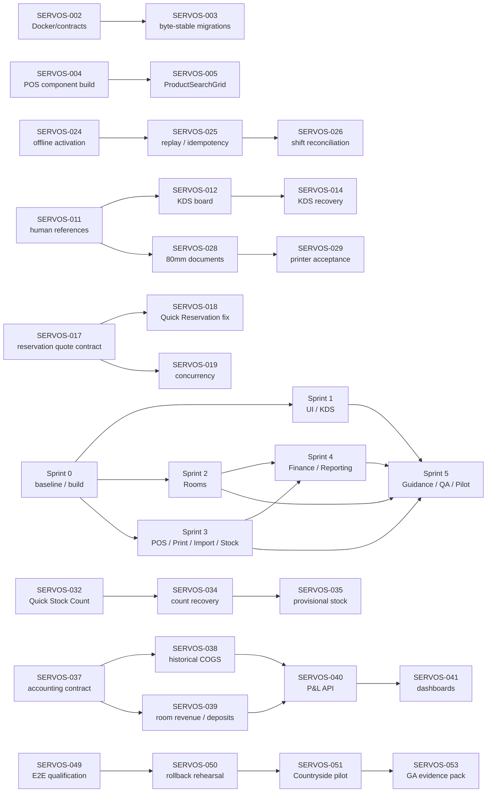

# SERVEOS Executable Sprint Board: Deep-Research Conversion of `Final-DEVsprint.md`

## Executive summary and sprint timeline

The backlog has been converted into an **executable 53-ticket sprint board** with Jira-style IDs, explicit dependencies, estimates, role-based ownership placeholders, acceptance criteria, test cases, rollout gates and importable labels.

The conversion deliberately does **not** assume that every issue discussed earlier is still broken in the current branch. Several important source-level repairs already exist and therefore become **verification/hardening tickets rather than duplicate implementation work**. For example, the API Dockerfile now explicitly copies the repository `contracts` directory into `/app/contracts`; the POS2 `ProductSearchGrid.tsx` currently contains syntactically valid JSX; `PaySheet.tsx` is presently a valid thin adapter around the existing payment panel; and all registered physical-document profiles currently resolve to `thermal-80mm`. fileciteturn5file0L1-L7 fileciteturn6file0L1-L7 fileciteturn7file0L1-L7 fileciteturn9file0L1-L7

At the same time, the repository review confirms that a number of the reported usability and workflow problems are **still real design or integration gaps**. The current KDS can fall back from a business order number to the raw order UUID and from the product name to the literal word `Item`; its conflict path tells the operator to refresh/review Activity but does not provide a complete conflict-resolution workflow. fileciteturn10file0L1-L7 The current Quick Reservation path can display exactly the reported “configured room-stay rate is unavailable” blocker, derives its rate from the property-level configured `ratePlanId`, and its inspected `roomReservation.create` call does not send a `ratePlanId`; by contrast, the main Rooms reservation flow explicitly selects a matching rate and submits `ratePlanId`. fileciteturn11file0 fileciteturn12file0L1-L2

The resulting board contains **24 P0 tickets**. This is intentionally conservative: the previously declared P0 requirements for human references, older-browser handling, thermal receipt cleanup, POS/offline safety, reservation correctness, financial reporting, import integrity and deployment safety remain release-blocking until their required evidence exists.

### Sprint timeline

| Sprint | Primary outcome | Tickets | P0 | Estimated engineering effort |
|---|---|---:|---:|---:|
| **Sprint 0** | Reproducible baseline, Docker/package safety, migration byte-safety, POS build hardening, design/performance baseline | 8 | 6 | 15.5 days |
| **Sprint 1** | Coherent UI, narrow navigation, human references, redesigned KDS, responsiveness | 8 | 1 | 27 days |
| **Sprint 2** | Reservation/rate parity, Quick Reservation correction, concurrency, Front Desk/folio integrity | 7 | 3 | 22 days |
| **Sprint 3** | Offline cash, legacy-browser handling, 80mm printing, imports, Quick Stock Count | 13 | 6 | 42 days |
| **Sprint 4** | Accounting model, historical COGS, P&L, charts, Kenyan fiscal decision | 8 | 5 | 32 days |
| **Sprint 5** | Interactive guidance, regression, rollback rehearsal, supervised Countryside pilot | 9 | 3 | 27 days |
| **Total** |  | **53** | **24** | **165.5 engineering days** |

The 165.5 days are **engineering effort rather than calendar duration**. Frontend, backend, hospitality, accounting, QA and DevOps work can proceed in parallel, so the six-sprint structure remains practical for a multi-role team.

The six gates are intentionally cumulative:

| Gate | Meaning |
|---|---|
| **G0** | Reproducible source/container/migrations; POS2 builds; P0 CI enforcement active |
| **G1** | UI/KDS staging acceptance; no major overlap or UUID leakage |
| **G2** | Reservation pricing and concurrency correctness |
| **G3** | Offline cash, stock, imports and 80mm transactional safety |
| **G4** | Reconciled financial reporting and Kenyan fiscal decision |
| **G5** | Full E2E/device testing, rollback rehearsal and supervised pilot |
| **GA** | Controlled production expansion only after G5 and zero open P0s |

The prioritisation reflects the Kenyan operating environment: intermittent connectivity, shared and lower-spec devices, cash and M-Pesa workflows, 80mm thermal hardware, property-local `Africa/Nairobi` dates, and fiscal/eTIMS considerations. KRA continues to describe electronic tax invoicing/eTIMS as a business compliance requirement, including for persons not registered for VAT, which is why the board contains a dedicated fiscal-decision gate rather than claiming that ordinary thermal receipt rendering establishes compliance. citeturn0search12turn0search13

## Repository-backed findings and backlog conversion

### Deployment and the previous packaging defect

The packaging defect should **not** simply be reopened as “Docker is broken”. The current API Dockerfile already has the repaired behaviour:

```dockerfile
COPY apps/api/src ./src
COPY apps/api/migrations ./migrations
COPY --chmod=0755 contracts /app/contracts
RUN find /app/contracts -type f -exec chmod 0644 {} +
USER node
```

That establishes that the source-level contracts packaging repair is present. fileciteturn5file0L1-L7

More importantly, the repository's POS2 release evidence records why deployment hardening still matters. The VPS Docker builder lacked BuildKit, the corrected image was built from canonical Git archive bytes, and SQL line-ending differences between ordinary Windows working-tree/archive material and staging caused legitimate migration-checksum rejection. The eventual deployment preserved checksum validation rather than editing applied migrations or weakening integrity checks. fileciteturn4file0L1-L10

That becomes three executable concerns:

**SERVOS-001** records branch/deployment evidence, **SERVOS-002** makes the contracts packaging repair a permanent regression gate, and **SERVOS-003** makes source archives/migrations byte-stable across Windows and the VPS.

This distinction is crucial. The right sprint task is now **“prove the repair cannot regress”**, not “hack the VPS again”.

### POS components and ProductSearchGrid

The reported malformed POS component/ProductSearchGrid defects also require careful status handling.

`ProductSearchGrid.tsx` exists on the current feature branch and is valid JSX. It implements barcode matching, search, category filtering, favourites ordering and responsive grid columns. However, almost the whole component is compressed into a few very long statements, making it unusually easy to damage during future edits and unnecessarily hard to review. fileciteturn6file0L1-L7

`PaySheet.tsx` is also valid at present and simply wraps `WebApiPaymentPanel` with `compact`. fileciteturn7file0L1-L7

Therefore:

- **SERVOS-004 P0** rechecks all malformed/partial POS component boundaries and installs compile/render regression guards.
- **SERVOS-005 P0** specifically closes the ProductSearchGrid JSX regression, reformats/refactors it and tests realistic catalogues and barcode flows.

The P0 severity is retained because a JSX/build regression can remove the cashier surface entirely even if the currently inspected source happens to be valid.

### Offline cash: not simply “feature absent”

The current capability implementation makes offline cash conditional on both a device/staff/business cohort match and the necessary `pos.sell`, `order.fire` and `payment.record` permissions. `pos2.localKitchenTickets` and `pos2.offlineAuthV2` build on the same offline capability. fileciteturn8file0L1-L7

The release evidence goes further: POS2 cohorts were configured for particular existing staff/device pairs, but **no production offline capability was preissued by deployment**. An eligible checkout operator still has to open the correct shift, configure offline checkout security and provision a time-limited capability online. The same release evidence records successful offline staging/replay tests, while also recording several remaining acceptance gaps. fileciteturn4file0L1-L10

So “offline cash disabled” can have several very different meanings:

> device not enrolled → staff lacks permission → no open owned shift → capability not provisioned → capability expired → browser only qualifies for online operation → genuine defect.

The board therefore does **not** add an unsafe “Enable Offline Cash” switch. **SERVOS-024 P0** requires ServOS to explain the exact reason, and **SERVOS-025/026 P0** preserve replay, till, handoff and reconciliation guarantees.

### Older browsers

The branch already contains a meaningful feature-probe layer. `browserCapabilities.ts` tests secure context, Web Crypto, IndexedDB, local date formatting, service workers/caches, locks and printing, returning `Full`, `Online only` or `Unsupported`. It also contains a browser-version baseline. fileciteturn20file0L1-L7

That means the outstanding P0 is no longer “add browser detection”; it is:

**prove that the capability classifications actually produce safe, understandable behaviour on the real machines Countryside intends to use.**

This is particularly important because the POS2 release evidence explicitly says exact older-browser versions had **not** been advertised as accepted. fileciteturn4file0L1-L10

**SERVOS-027 P0** therefore forbids a polyfill or legacy bundle from converting a browser with inadequate cryptography or durable storage into a supposed offline cashier. The fallback is **Online only** or **Unsupported**, accompanied by a clear message instead of a blank application.

### Human references, receipt rendering and 80mm

The thermal profile is already considerably better than the earlier state. The repository now defines only `thermal-80mm` and maps sales receipts, payment acknowledgements, refunds, KOT/BOT, close-day reports, goods receipts, purchase orders, guest documents and other supported physical documents to that profile. The same source also contains a legacy-reference helper and explicit original/reprint semantics. fileciteturn9file0L1-L7

But source configuration is not physical acceptance. The POS2 release evidence explicitly records that actual paper delivery, printer/driver/cutter/QR acceptance remained unverified. fileciteturn4file0L1-L10

The board therefore separates:

**SERVOS-028 P0 — renderer/document correctness**

from

**SERVOS-029 P1 — physical printer/cutter acceptance**.

Human references are handled centrally in **SERVOS-011 P0**, rather than fixing UUIDs independently in KDS, Rooms, receipts, inventory and finance. That avoids creating five different short-ID schemes.

### KDS

The current KDS source directly supports the screenshots and earlier findings.

The primary reference shown on a ticket is:

```tsx
orderData.orderNumber || ticket.order.id
```

and the item title uses:

```tsx
ticket.item.productName || 'Item'
```

so missing business data can expose a raw UUID or meaningless generic product label. fileciteturn10file0L1-L7

The same source has sensible status transitions — `FIRED → PREPARING → READY → SERVED` — but conflict/unknown failure recovery remains primarily message-driven. fileciteturn10file0L1-L7

This became four deliberately separate tickets:

- **SERVOS-012:** dense responsive KDS.
- **SERVOS-013:** durable product-name/modifier snapshot.
- **SERVOS-014:** safe conflict recovery.
- **SERVOS-015:** simplified station/status controls.

That decomposition avoids a common sprint failure in which one giant “Improve KDS” ticket becomes impossible to estimate, test or close.

### Quick Reservation and room rates

This is the strongest source-confirmed P0 in the hospitality backlog.

The Quick Reservation component obtains:

```ts
const configuredRate =
  rates.find(rate => rate.id === policy?.ratePlanId)
```

then only treats it as selectable when its room type matches the chosen room. If not, it creates exactly the blocker reported by the user:

> The configured room-stay rate is unavailable. Review the room-stay settings before booking.

The inspected create command sends room, customer, stay type, guest count, startsAt and endsAt, but does **not** include `ratePlanId`. fileciteturn11file0

Meanwhile, the main Rooms workflow calculates matching rates from the selected room type and explicitly sends:

```ts
ratePlanId: rate.id
```

alongside expected versions for the reservation, room, rate and guest. fileciteturn12file0L1-L2

This is precisely why **SERVOS-017/018/019 are separate P0s**:

- establish one authoritative quote/rate contract;
- fix Quick Reservation parity;
- independently prove concurrent booking safety.

Simply adding `ratePlanId` to one React payload without confirming the server pricing contract would be too narrow.

### Stock Count and Quick Stock Count

The current physical-count implementation already has solid accounting-safety foundations: one command ID, expected quantities, inventory revisions, online-only confirmation, and support for sealed containers plus open volume. fileciteturn13file0L1-L7

The usability problem is equally clear. For selected-item Quick Count, the dialog currently renders the available stock records as a checkbox list before the user counts them. On a large bar/storeroom catalogue, that is much slower than the real-world task of scanning or searching the few products physically being counted. fileciteturn13file0L1-L7

The uncertainty path also sets the count as submitted for pending/unknown/conflict outcomes and can surface the generic “Review Activity before submitting again” recovery language. fileciteturn13file0L1-L7

That becomes:

- **SERVOS-032:** fast search/scan Quick Count.
- **SERVOS-033:** bottle/open-volume counting ergonomics.
- **SERVOS-034:** understandable recovery.
- **SERVOS-035:** consistent provisional stock semantics across the application.

This preserves the existing safety rules instead of simplifying stock count by making it less auditable.

### Guidance and onboarding

The repository already has a substantial guide registry covering till opening, first sale, M-Pesa, receipt printing, stock count, purchasing, reservations and other tasks. It also has a known-anchor registry and `validateGuides()`. fileciteturn15file0L1-L7

The key implementation weakness is that the final automatic validation shown in `core.ts` is guarded by development mode. fileciteturn15file0L1-L7

That does not explain every reported tour failure, because runtime failures can also come from lazy navigation, permission-hidden targets, responsive layout and timing. The board therefore has three tickets instead of one vague “fix help” item:

- **SERVOS-045:** make anchor validity a release/build concern.
- **SERVOS-046:** repair runtime navigation/loading/missing-target recovery.
- **SERVOS-047:** validate actual first-shift onboarding by role.

### Navigation and visual coherence

`WebBusinessApp.tsx` still exposes a large workspace vocabulary including Home, POS, KDS, Catalog, Inventory, Procurement, Front Desk, Guest Accounts, Housekeeping, Rooms, Maintenance, Floorplan, Assets, Master Data, Refunds, Finance Controls, Settings, Finance, Staff, Administration, Activity and Help. Different business presets then filter that large set. fileciteturn16file0L1-L2

The design system does have useful primitives, but the spacing token set itself remains small — for example page, section and control spacing — while many runtime files still construct their own large Tailwind class strings. fileciteturn22file0L1-L7

This supports the architectural decision to fix spacing/overlap through **shared primitives and a compact navigation system**, rather than screenshot-by-screenshot CSS patches.

### Reporting and full P&L

The current dedicated reporting code already provides useful foundations: sales summary, sales register, current stock on hand and nightly occupancy. It applies `reports.view`, uses read-only/repeatable-read reporting transactions for sales, carries `Africa/Nairobi` as the default report timezone, and exposes explicit stock-valuation limitations. fileciteturn19file0L1-L7

What this file does **not** provide is a complete P&L model with historical COGS, accommodation-deposit recognition, full operating-account classification and period-close controls.

That is why the finance stream starts with accounting truth rather than charts:

**SERVOS-037 → SERVOS-038/039 → SERVOS-040 → SERVOS-041**

Only after reconciled P&L data exists should the dashboard confidently visualise gross profit or profit figures.

### Import approval

The current import centre is already cautious about staging, dry runs and audited application, but `Apply reviewed import` is conditionally rendered only when `canExecute` is true. fileciteturn21file0L1-L7

That supports the earlier observation that a reviewer can interpret the missing button as a broken interface rather than a permission boundary.

**SERVOS-030** fixes the explanation.

**SERVOS-031 P0** separately covers business-data correctness — cost/unit/tax anomalies — so improving the permission UI cannot accidentally be treated as approval of questionable imported data.

## Executable sprint board

The full Markdown export contains the description, owner role, dependencies, acceptance criteria, test cases, labels and rollout gate for **every one of these 53 tickets**.

### Sprint 0 — baseline, build and safety

- [ ] **SERVOS-001 P0** — Freeze branch, deployment and evidence baseline — 1.5d
- [ ] **SERVOS-002 P0** — Lock in the repaired API Docker/contracts packaging path — 2d
- [ ] **SERVOS-003 P0** — Make migrations and release archives byte-stable across Windows and VPS — 2d
- [ ] **SERVOS-004 P0** — Repair and regression-proof malformed POS2 component boundaries — 2d
- [ ] **SERVOS-005 P0** — Close ProductSearchGrid JSX regression and improve maintainability — 2d
- [ ] **SERVOS-006 P1** — Establish shared design-token and spacing contract — 2.5d
- [ ] **SERVOS-007 P1** — Create low-end device, responsive and performance baseline — 2d
- [ ] **SERVOS-008 P0** — Enforce P0 CI and release blocker policy — 1.5d

**Sprint exit:** a fresh checkout must build reproducibly; the API image must contain the required contracts; migrations must retain canonical checksums; the POS2 UI must compile; and subsequent developers must have one shared design/performance baseline.

### Sprint 1 — UI, navigation and KDS

- [ ] **SERVOS-009 P1** — Replace inconsistent local UI primitives and fix overlap defects — 4d
- [ ] **SERVOS-010 P1** — Implement compact role-based navigation shell — 4d
- [ ] **SERVOS-011 P0** — Introduce server-owned human-readable business references — 4d
- [ ] **SERVOS-012 P1** — Redesign KDS as a dense responsive ticket board — 4d
- [ ] **SERVOS-013 P1** — Persist and display durable KDS item snapshots — 3d
- [ ] **SERVOS-014 P1** — Make KDS conflict and uncertain-outcome recovery actionable — 3d
- [ ] **SERVOS-015 P1** — Simplify KDS station and status filters — 2d
- [ ] **SERVOS-016 P1** — Optimise shell and route loading for snappy interaction — 3d

**Sprint exit:** normal operators should no longer encounter raw UUIDs in primary workflows, KDS should use the available screen effectively, navigation should be substantially narrower, and the measured response time on lower-spec hardware should improve from the Sprint 0 baseline.

### Sprint 2 — Rooms and hospitality correctness

- [ ] **SERVOS-017 P0** — Define one authoritative reservation quote and rate-selection contract — 3d
- [ ] **SERVOS-018 P0** — Resolve Quick Reservation configured-rate-unavailable failure — 3d
- [ ] **SERVOS-019 P0** — Prove transactional room availability and prevent double-booking — 4d
- [ ] **SERVOS-020 P1** — Split Rooms setup from daily Front Desk operations — 4d
- [ ] **SERVOS-021 P1** — Reconcile folio, deposit, room-move and checkout posting rules — 4d
- [ ] **SERVOS-022 P1** — Harden hospitality time-zone and business-day behaviour — 2d
- [ ] **SERVOS-023 P1** — Add human reservation references and searchable confirmations — 2d

**Sprint exit:** Quick Reservation and full Rooms booking must produce the same authoritative pricing outcome, simultaneous operators must not double-book a room, and receptionists must not need to understand rate-plan implementation details just to make a normal reservation.

### Sprint 3 — cashier, printing, imports and stock count

- [ ] **SERVOS-024 P0** — Make offline-cash availability truthful, diagnosable and enrolment-driven — 3d
- [ ] **SERVOS-025 P0** — Re-verify offline cash idempotency, replay and uncertain outcomes — 4d
- [ ] **SERVOS-026 P0** — Complete till, shift, handoff and manager reconciliation UX — 3d
- [ ] **SERVOS-027 P0** — Implement legacy-browser capability gate and graceful fallback — 3d
- [ ] **SERVOS-028 P0** — Finish 80 mm-only thermal layouts and remove technical receipt clutter — 4d
- [ ] **SERVOS-029 P1** — Complete physical printer, cutter and print-queue acceptance — 3d
- [ ] **SERVOS-030 P1** — Make import execution permission state explicit — 2d
- [ ] **SERVOS-031 P0** — Block unsafe catalogue imports on cost, unit and tax anomalies — 4d
- [ ] **SERVOS-032 P1** — Redesign Quick Stock Count for fast bar and storeroom counting — 4d
- [ ] **SERVOS-033 P1** — Simplify sealed bottle and open-volume stock counting — 3d
- [ ] **SERVOS-034 P1** — Make stock-count drafts, conflicts and Activity recovery understandable — 3d
- [ ] **SERVOS-035 P1** — Unify provisional stock presentation across inventory surfaces — 3d
- [ ] **SERVOS-036 P1** — Keep M-Pesa and external tenders authoritative and online-safe — 3d

This is deliberately the largest sprint by raw effort. It contains several parallel workstreams rather than expecting one engineer to complete 42 days sequentially.

The important real-world principle is that **offline cash is not equivalent to offline every-payment-method**. The current guidance itself describes manually recorded M-Pesa as operator-confirmed rather than provider-verified. fileciteturn15file0L1-L7 SERVOS-036 therefore keeps unverified external tender states distinct from confirmed cash rather than broadening offline support recklessly.

### Sprint 4 — financial truth and management reporting

- [ ] **SERVOS-037 P0** — Approve chart of accounts and complete P&L accounting contract — 4d
- [ ] **SERVOS-038 P0** — Implement historical COGS and inventory valuation evidence — 5d
- [ ] **SERVOS-039 P0** — Define accommodation revenue, deposits and folio accounting — 4d
- [ ] **SERVOS-040 P0** — Build reconciled P&L reporting API and period-close controls — 5d
- [ ] **SERVOS-041 P1** — Build management dashboards with charts and drill-down — 5d
- [ ] **SERVOS-042 P1** — Replace ambiguous zero reports with explicit data states — 2d
- [ ] **SERVOS-043 P1** — Add report exports and 80 mm thermal summaries — 3d
- [ ] **SERVOS-044 P0** — Complete Kenyan eTIMS and tax compliance decision gate — 4d

The KRA gate is intentionally a **decision/compliance ticket**, not a promise that the existing code is eTIMS compliant. KRA's own published material states that persons carrying on business are expected to generate and transmit electronic tax invoices through eTIMS; a qualified Kenyan tax/accounting review therefore belongs in the production gate. citeturn0search12turn0search13

### Sprint 5 — guidance, release qualification and pilot

- [ ] **SERVOS-045 P1** — Make guide target validation a production build check — 2d
- [ ] **SERVOS-046 P1** — Repair guided-tour navigation, loading and missing-target recovery — 3d
- [ ] **SERVOS-047 P1** — Create role-specific first-shift onboarding guides — 3d
- [ ] **SERVOS-048 P1** — Run complete visual, accessibility and device regression — 4d
- [ ] **SERVOS-049 P0** — Run end-to-end operational journeys and load tests — 4d
- [ ] **SERVOS-050 P0** — Rehearse staged deployment, feature flags and V2-safe rollback — 3d
- [ ] **SERVOS-051 P0** — Run supervised Countryside pilot and operator sign-off — 3d
- [ ] **SERVOS-052 P2** — Review and safely integrate QR ordering — 3d
- [ ] **SERVOS-053 P1** — Publish final release runbook and evidence pack — 2d

The POS2 production evidence is particularly important to rollback design: once V2 offline cash may exist, the old API alone does not decode that evidence, so rollback must retain the candidate decoder/reconciliation path rather than blindly reverting traffic, clearing browser storage or restoring an older database over later writes. fileciteturn4file0L1-L10

## Dependency graph

The Markdown export contains this Mermaid graph. It deliberately shows both sprint-level sequencing and the most safety-critical ticket dependencies.



The most important dependency decisions are intentional.

**Human references precede the KDS and thermal cleanup** so those surfaces do not invent independent short-ID schemes.

**The reservation quote contract precedes the UI fix** so Quick Reservation is not repaired through a one-off frontend workaround.

**Accounting policy precedes P&L charts** so the application does not render an attractive but financially misleading “profit” dashboard.

**Offline replay precedes pilot rollback** because a deployment rollback must be proven against actual V2 transaction evidence, not merely against an empty browser.

**Quick Stock Count UX precedes conflict/recovery polish** because the recovery mechanism needs to understand the final count-draft model.

## Export files and Jira import mapping

Both requested artifacts have been generated and validated in the active runtime.

### CSV — ready for Jira field mapping

**53 tickets + 1 header row, 12 columns, UTF-8 BOM, comma-separated and every field quoted.**

[Download SERVEOS_Executable_Sprint_Board_20261012.csv](sandbox:/mnt/data/SERVEOS_Executable_Sprint_Board_20261012.csv)

**SHA-256**

```text
c79bb44db2100ca96355b7f7c4f5059803b03184cebaeeacfc3194db64ea12f1
```

CSV fields are:

```text
"Ticket ID"
"Title"
"Description"
"Priority"
"Estimate (days)"
"Owner Role"
"Dependencies"
"Acceptance Criteria"
"Test Cases"
"Labels"
"Sprint Assignment"
"Rollout Gate"
```

The file deliberately uses **Title** rather than assuming the name of the destination Jira system field. During import, map `Title → Summary`. Atlassian's Jira Cloud documentation says at least one CSV field must be mapped to the Summary field, and other CSV columns can then be mapped to the relevant project fields. citeturn0search2

For an existing Jira Cloud project/space using the administrator External System Import route, Atlassian notes that statuses, work types, fields and field options need to exist in the destination before import. Therefore the cleanest setup is to create these optional custom fields first:

```text
Estimate (days)      Number
Owner Role           Single-line text / select
Dependencies         Text
Acceptance Criteria  Paragraph text
Test Cases           Paragraph text
Rollout Gate         Select or text
Sprint Assignment    Existing Sprint field or mapped equivalent
```

Then map `Labels` to Jira Labels and `Priority` to the existing P0/P1/P2/P3 values or to equivalent Jira priority names. citeturn0search11

No named individual has been assigned. The board uses placeholders such as:

```text
Frontend Engineer
POS/Backend Engineer
Hospitality Backend Engineer
Accounting/Backend Engineer
QA Engineer
Release/DevOps Engineer
Product/Operations Lead
```

This keeps ownership explicit without fabricating team members.

### Markdown — complete working sprint board

The Markdown export contains all 53 tickets grouped under Sprint 0 through Sprint 5, each as a checklist item with its full description, acceptance criteria, tests, dependency IDs, labels and gate.

[Download SERVEOS_Executable_Sprint_Board_20261012.md](sandbox:/mnt/data/SERVEOS_Executable_Sprint_Board_20261012.md)

**SHA-256**

```text
2821dcd4cb9dd5f0e9c00ca15df02a77dc7004c0ddfa1698d95d678b6b06ddd2
```

The Markdown artifact is approximately 52 KB and 445 lines.

### Label strategy

Every ticket carries exactly one primary area from the requested taxonomy:

```text
area:UI
area:KDS
area:ROOMS
area:POS
area:FIN
area:PRINT
area:OPS
area:QA
area:HELP
area:STOCK
area:IMP
```

Secondary labels communicate cross-cutting concerns, for example:

```text
risk:P0
market:KE
low-end-device
80mm
offline
human-reference
concurrency
etims
mpesa
performance
responsive
recovery
```

QR ordering deliberately uses `area:POS`, and browser compatibility uses `area:QA`, so the primary area vocabulary remains within the requested set.

## Rollout gates and non-negotiable release controls

The board is built around a strict distinction between **source present**, **implemented**, **staging-verified**, **hardware-verified**, and **pilot-accepted**.

That distinction is justified by the current POS2 evidence. The repository records a deployed POS2 update with extensive CI, API, browser, replay and staging evidence, yet the same record explicitly leaves physical paper/printer/cutter/QR acceptance, exact older-browser acceptance, offline M-Pesa, full inventory provisional-state presentation and complete real-operator acceptance outside the verified boundary. fileciteturn4file0L1-L10

### Gate G0 — engineering integrity

No UX sprint begins from an unknown deployment state.

Required evidence includes:

```text
exact repository source
deployed source
API image digest
PWA release
schema readiness
migration checksums
contracts packaging
clean POS2 production build
retained rollback artefacts
P0 issue register
```

A developer should be able to recreate the candidate without manually repairing the image on the VPS.

### Gate G1 — human interface integrity

The application must feel like one system.

The gate fails when:

```text
raw UUIDs remain in primary workflows
search icons overlap text
buttons or modals clip
navigation obscures operational content
KDS wastes large amounts of usable screen
state labels expose backend terminology unnecessarily
critical interaction budgets regress on low-end devices
```

The shared UI work is therefore not “polish after features”. It is part of operational correctness: an operator who cannot distinguish a pending transaction from a completed transaction is facing a correctness problem, not merely a cosmetic problem.

### Gate G2 — hotel correctness

No room UI improvement can compensate for ambiguous rate and concurrency rules.

G2 requires:

```text
Quick Reservation rate parity
server-authoritative quote
rate-plan snapshot
nightly/day-use correctness
Africa/Nairobi boundary testing
transactional room allocation
room block/maintenance enforcement
folio/deposit scenario reconciliation
```

The current source difference between Quick Reservation and `WebApiRoomsView` makes this gate particularly important. fileciteturn11file0 fileciteturn12file0L1-L2

### Gate G3 — transaction and physical-operation integrity

No cashier/stock/print expansion occurs until:

```text
offline eligibility is understandable
offline replay is idempotent
till handoff is safe
legacy browsers fail gracefully
80mm renderer tests pass
actual printer testing is recorded
unsafe import anomalies are blocked/reviewed
stock-count uncertainty is recoverable
unverified M-Pesa cannot masquerade as confirmed payment
```

The current stock-count implementation correctly requires API connectivity for final confirmation and uses inventory revisions/expected balances; those safety properties must survive the new faster UX. fileciteturn13file0L1-L7

### Gate G4 — financial truth

Charts are not the gate. Reconciliation is.

Before `Gross profit`, `Operating profit` or `Net profit` is presented as an authoritative business metric, SERVEOS must know:

```text
which revenue is recognised
which costs belong to sold inventory
how guest deposits are treated
how supplier payments differ from expenses
how refunds/returns affect revenue and stock
whether historical cost evidence exists
what data coverage is incomplete
which period is open or closed
```

The current reporting API is already useful for sales, payments, stock and occupancy and even explicitly warns that current average unit cost is only appropriate for current stock rather than historical periods. fileciteturn19file0L1-L7 That is a good foundation for SERVOS-038 and SERVOS-040 because the code is already signalling the distinction between current valuation and historical financial evidence.

### Gate G5 — real-world pilot integrity

A browser test suite is necessary but not sufficient.

G5 requires the full real-business sequence:

```text
waiter
  ↓
order
  ↓
KDS
  ↓
cashier
  ↓
payment
  ↓
80mm paper

reception
  ↓
availability/rate
  ↓
reservation
  ↓
check-in
  ↓
folio/deposit
  ↓
checkout

stockkeeper
  ↓
receive/count
  ↓
variance
  ↓
recovery/reconciliation

manager
  ↓
sales/reporting
  ↓
source drill-down
  ↓
P&L/reconciliation
```

It must be exercised using actual intended roles and representative devices, not administrator accounts on development laptops.

The interactive helper is included in the same pilot because its success criterion is deliberately human:

> a newly employed waiter, cashier, receptionist or stock controller should be able to finish the basic workflow without a developer explaining where to click.

The repository already has role-aware guide definitions and real transactional success-operation hooks, which is a strong foundation for that goal. fileciteturn14file0L1-L2 fileciteturn15file0L1-L7

### General-availability rule

The board's final release rule is:

> **No P0 may be silently downgraded.**

A P0 can reach release only when one of two conditions is true:

**A.** Its defined acceptance evidence passes.

**B.** The affected feature is deliberately disabled through a safe feature flag and the UI honestly explains its unavailable state.

The following are therefore prohibited as “fixes”:

```text
clearing IndexedDB to remove offline conflicts
deleting queued transactions
blindly resubmitting uncertain money commands
rewriting an applied migration to fix a checksum
restoring an older database over newer financial writes
showing a payment as successful after a network timeout
bypassing room availability locking
generating authoritative sequence numbers only in a browser
calling current product cost historical COGS
calling a deposit room revenue simply because cash arrived
calling an ordinary 80mm receipt eTIMS-compliant without the required fiscal evidence
hiding an unavailable function without telling the operator why
```

The resulting sprint board is consequently not just a feature checklist. It establishes a progression from **reproducible code → understandable UI → transaction correctness → accounting truth → real staff/device acceptance**, which is the safer route to making SERVEOS genuinely fast, intuitive and dependable in a Kenyan hospitality operation.